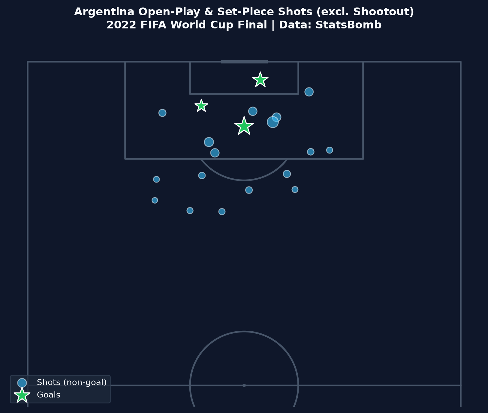

# OpenScout Intelligence

A full-stack football scouting and match event analytics platform powered by **Hudl/StatsBomb Open Data**, **FastAPI**, **PostgreSQL**, and **Next.js**.



## Architecture

- **Backend (`/backend`)**: Async FastAPI, SQLAlchemy 2.0, PostgreSQL 16 (hybrid relational + `JSONB` event schema), Alembic migrations, `statsbombpy`, `pandas`, `mplsoccer`.
- **Frontend (`/frontend`)**: Next.js 15, TypeScript, Tailwind CSS (Milestone 4).

## Quick Start (Backend)

1. Start PostgreSQL:
   ```bash
   docker compose up -d
   ```
2. Install dependencies with `uv`:
   ```bash
   cd backend
   uv sync
   ```
3. Run the API:
   ```bash
   uv run uvicorn app.main:app --reload
   ```
